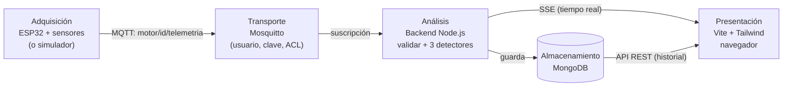

# Arquitectura y flujo del dato



## Flujo completo del dato
1. **Adquisición:** cada segundo el ESP32 lee temperatura, humedad y caudal y arma un JSON.
2. **Transporte:** lo publica en `motor/{id}/telemetria` del broker Mosquitto, con usuario y contraseña.
3. **Análisis:** el backend está suscrito. Valida el mensaje (si es inválido lo descarta y lo cuenta) y lo pasa por los tres detectores.
4. **Almacenamiento:** guarda la medición en MongoDB con el resultado de cada algoritmo y la configuración usada; si un detector pasa a "alerta" guarda además un evento anómalo.
5. **Presentación:** el backend manda la medición por SSE al navegador (tiempo real). Para el historial, el navegador consulta la API REST, que lee de MongoDB.

## Responsabilidades
| Capa | Pieza | Archivos |
|---|---|---|
| Adquisición | ESP32 / simulador | `firmware/`, `simulador/` |
| Transporte | Mosquitto | `mosquitto/`, `docker-compose.yml` |
| Análisis | Validación y detectores | `backend/analisis.js`, `backend/detectores/` |
| Almacenamiento | MongoDB | `backend/modelos.js` |
| Presentación | API + interfaz | `backend/server.js`, `frontend/` |

## Convención de temas MQTT
| Tema | Quién publica | Contenido |
|---|---|---|
| `motor/{id}/telemetria` | Dispositivo | Lecturas (JSON) |
| `motor/{id}/estado` | Dispositivo y broker (Last Will) | `{"estado":"online"}` u `{"estado":"offline"}` (retenido) |

`{id}` es el identificador del dispositivo, por ejemplo `bomba-01`.

## Mensaje de telemetría (JSON)
```json
{
  "deviceId": "bomba-01",
  "runId": "run-001",
  "ts": "2026-11-19T20:15:30.000Z",
  "lecturas": { "temperatura_C": 40.2, "humedad_pct": 45.1, "caudal_Lmin": 6.02 },
  "unidades": { "temperatura_C": "°C", "humedad_pct": "%HR", "caudal_Lmin": "L/min" }
}
```
Si el dato viene de un CSV grabado, el simulador agrega `"reproduccion": true` y la interfaz lo muestra como **REPRODUCCIÓN**.

| Campo | Significado |
|---|---|
| `deviceId` | Quién mide (debe coincidir con el `{id}` del tema) |
| `runId` | Identificador de la corrida experimental |
| `ts` | Marca de tiempo ISO 8601 en UTC |
| `lecturas` / `unidades` | Valores y sus unidades |

## Accesos (sin credenciales expuestas)
Broker propio, sin acceso anónimo. Las contraseñas están en `.env` y `mosquitto/passwd`, que **no se suben a Git**.
| Usuario | Permisos |
|---|---|
| `backend` | Solo leer `motor/+/telemetria` y `motor/+/estado` |
| `dispositivo` | Solo publicar en esos temas |

## Datos inválidos y desconexiones
- JSON malformado, campos faltantes, lecturas no numéricas o `deviceId` distinto al del tema → se descartan y se cuentan en `/api/estado` (`invalidos`).
- Si cae el broker, el backend reintenta cada 2 s y se vuelve a suscribir al reconectar. El navegador reconecta el SSE solo.
- Si el dispositivo se cae, el broker publica su Last Will (`offline`). Si dejan de llegar datos, la interfaz muestra "SIN DATOS RECIENTES".
